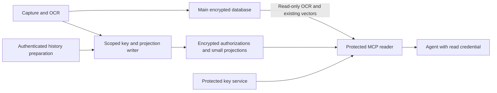

# Unattended Agent Access

CarbonPaper provides an opt-in, read-only credential for its complete prepared
text history through local MCP. The permission is independent of an unlocked
application session and of the background-organization preference. It includes
future captures and resumes after Windows sign-in and background application
startup. Fully exiting the application stops the endpoint.

The permission reduces the protection supplied by application locking: anyone
holding a credential can retrieve the authorized text while the UI is locked.
Use a normal interactive session with automatic locking disabled when unattended
Agent access is unnecessary. Revocation prevents further authorized responses;
it cannot recover text already returned.

## Scope and behavior

| Operation or event | Behavior |
| --- | --- |
| Read capture times, application names, window titles, categories, recorded URLs and links | Available across the prepared active dataset |
| Read OCR, saved recap activities, corrections, cluster membership and summaries | Available when recorded; ordinary content and PII filters still apply |
| Enumerate dates and captures | All prepared history, using existing pagination and explicit Unix millisecond timestamps |
| Search visible words | Shared keyword and fuzzy matching rules; explanations describe the representative OCR row |
| Search screen appearance | Existing Chinese-CLIP vectors and a text-only query embedding; missing vectors are reported |
| Search recaps | Corrected keyword results, existing MiniLM vectors, saved calendars, coverage and ranking revisions |
| Read screenshots, thumbnails, crops, binary attachments, image paths or archive keys | Outside the permission |
| Edit summaries, delete data, change settings or issue credentials | Outside the read-only catalog |
| Lock or expire the UI session | Credential remains active; ordinary UI access retains its authentication requirements |
| Restart Windows or the application | Access resumes after sign-in and background startup once reconciliation completes |
| Revoke one credential | Other credentials remain active; requests admitted under the revoked revision are rejected before response delivery |
| Disable unattended access | All grants and service key authority are retired, and the reader stops |
| Export a backup, compact the database or repair its search index | Reads pause during maintenance and resume after reconciliation |
| Import a backup or change the data directory | Old grants are retired; the active dataset requires a new explicit authorization |

All ten existing read tools are available. The two summary-write tools are
omitted from the catalog and rejected if called directly. In-process AI tools
continue to use the authenticated interactive dispatcher.

## Settings and introduction

Privacy settings present one colored **Security level** control that combines
automatic locking and unattended permission:

| Level | Automatic locking | Unattended permission |
| --- | --- | --- |
| Strict | 15 minutes; backgrounding also locks the existing UI session | Off |
| Relaxed (recommended) | No automatic expiry; manual locking and application exit still end the session | Off |
| Unattended | No automatic expiry; manual locking and application exit still end the UI session | On |
| Custom | Individually adjustable | Individually adjustable |

Custom preserves its explicit selection even when its values match a preset.
The old standalone unlock-duration row is consolidated into Custom. Background
organization, content categories and PII filtering remain independent settings.
Installing protected components can be done separately from enabling background
organization through **Install components** in Privacy settings.

Selecting Unattended or switching unattended permission on first presents a risk
decision. Cancelling keeps the effective policy unchanged. Enabling permission
then requires fresh native Windows verification before the coordinated settings
are saved. Applying a policy serializes with MCP listener transitions; failed
permission changes restore the previous timeout preference without recreating
revoked credentials. Permission changes reconcile service authority and the
desktop writer state; a retired view is prepared again only after fresh consent.

The introduction appears once after authenticated startup, following required
setup and the search-index upgrade. It explains the historical and future text
scope, locked/startup behavior and credential exposure, recommends Relaxed when
unattended access is unnecessary, then offers the same presets and Custom fields.
Choices remain a draft until **Apply settings**. The risk decision stays within
the active wizard, so it remains usable under startup overlay coordination.
**Keep current settings** records the introduction as seen without changing
permissions; **Feature guide** in Privacy settings reopens it.

**AI → Agent access** retains connection and privacy-filter controls and manages
unattended credentials. Text preparation must finish before creating a labeled
credential; interrupted preparation offers an explicit continuation action.
Once issuance starts, concurrent capture synchronization does not cancel it.
Reader key acquisition and requests still require a complete, synchronized view.
Each credential has an optional expiry, last-use information, replacement and
independent revocation. Interactive token-copy, token-rotation and smoke-test
controls are shown only in interactive mode. Setup instructions use the active
mode's credential placeholder and never include an actual bearer secret.

## Application commands

The native settings/main-window commands are:

- `security_get_policy`: public policy metadata, runtime availability, progress
  and the introduction marker, restricted to the main/settings windows.
- `security_set_policy`: authenticated coordinated preset or Custom mutation.
- `security_acknowledge_intro`: window-authorized UI progress marker only.
- `agent_access_get_status`: availability, preparation progress and credential
  metadata. It returns no archive text, paths, keys or bearer secrets. Labels
  are omitted while the UI is locked.
- `agent_access_set_enabled`: enable or disable persistent permission. Enabling
  performs fresh Windows verification even with a valid application session.
- `agent_access_resume`: continue interrupted preparation using an ordinary
  authenticated session.
- `agent_access_issue_credential`: issue a labeled credential, optionally with
  an expiry, or replace an existing one. Fresh Windows verification is required.
- `agent_access_revoke_credential`: independently revoke a credential.

A random credential is delivered once through the native Windows clipboard.
Neither the plaintext credential nor content keys cross frontend IPC. Failed
clipboard delivery revokes the newly issued grant. Replacement delivers the new
credential before revoking the old one. Lost credentials are replaced, because
the service stores a hash rather than a recoverable plaintext secret.

Exactly one listener owns the configured loopback MCP port. Interactive mode
uses the desktop listener and its ordinary token; unattended mode uses the
protected reader and independently issued credentials. Listener transitions
share the existing lifecycle lock. Existing interactive token-copy, rotation
and smoke-test commands are unavailable in unattended mode.

## Lightweight authorization and source reuse

[`carbonpaper-agent-access`](../src-tauri/agent-access/) is a separate Rust
crate containing typed projections, encrypted authorizations, filters,
pagination and the unattended dispatcher. Its fixed read-only source connector
opens `screenshots.db` beside the service-authorized `agent-memory.db`. It does
not link the desktop archive repository, CNG private key context, screenshot
loader or an arbitrary file-read API.

The SQLCipher-encrypted `agent-memory.db` uses an independently random content
key. It keeps small text projections for capture metadata, links, clusters,
summaries, recap activities, calendars and privacy settings. OCR rows contain
identifiers, revisions, ciphertext digests and wrapped OCR keys. Vector access
wraps each existing vectors-domain key once; recap search access wraps the key
for its existing saved payload. The reader reuses OCR bodies, vector arrays and
HMAC posting lists in the main database. The Agent database keeps no full-text
tables or second OCR/vector copy.

The source connector receives separately wrapped public-bootstrap SQLCipher
and HMAC search keys. It receives neither the archive master key nor screenshot
keys. Key envelopes authenticate the dataset, generation, domain, record
identity and ciphertext digest. The transactional outbox uses a second
independently random key and authenticates its dataset and generation. These
keys are independent of bearer credentials.

Tool responses allow text, identifiers, revisions, timestamps, recorded
relationships and numeric geometry. They exclude arbitrary screenshot
metadata, icons, image locations, image bytes, key envelopes, prompts,
reasoning and provider diagnostics. Recap summaries and evidence are decoded
into explicit fields.

Historical preparation unwraps OCR, recap-search and vector-domain keys while
authenticated, then rewraps them for the authorized generation. It decodes only
the text needed by small projections and never opens screenshots or thumbnails.
Capture and processing stage freshly generated row/domain keys before clearing
them, so new OCR and vectors can become available while the UI is locked.
Other projection text is staged as bounded, short-lived Agent-key-encrypted
material. Source triggers return encrypted key/projection events, or
identifier-only gaps when the required material is unavailable. Ciphertext
digests avoid carrying full OCR or recap-search payloads through those events.
Plaintext SQL decryption functions retain their `DIRECTONLY` restriction.

OCR search reuses the main database's HMAC bitmap index and shared fuzzy
matching and ranking rules. The desktop writer fills missing postings from
authorized OCR even while locked, decrypting and hashing outside the main
database mutex and committing at most 32 OCR rows per transaction. The reader
checks OCR and recap-search digests before decrypting their source payloads;
semantic reads validate the existing vector model, revision and dimensions.
CLIP scans read vectors in bounded pages.

Events commit alongside source changes. Revision fencing, tombstones and
source deletion checks prevent older callbacks from overwriting newer records
or reviving deleted children. Historical preparation uses a persistent checkpoint
and commits each bounded source page in one Agent transaction. Outbox batches
commit their record updates and applied position together. Preparation drains
concurrent updates between pages and logs cumulative phase, row-key, read and
write timings at bounded intervals. It pauses on lock, cancellation or
maintenance. The main database must remain available; missing files, mismatched
datasets or changed ciphertext fail the read rather than return a stale copy.

## Protected reader and authority

[`carbonpaper-mcp-reader`](../src-tauri/agent-access/src/bin/reader.rs) owns
the unattended HTTP endpoint and receives configuration through stdin. Keys and
credentials are never command-line arguments. A Windows Job stops the reader
and its query worker descendants when the desktop exits.

The existing app-bound ledger stores independent Agent policy, protected view
keys, credential hashes, labels, expiry and last-use timestamps. Grants bind the
owning SID, dataset and view generation. The reader role is derived from the
kernel-observed process identity, protected executable location and signed
runtime manifest. It can acquire only Agent content keys and validate Agent
requests; archive and background-processing operations remain restricted to the
desktop role. The reader never receives outbox write material.

Query embeddings use the existing protected Rust semantic worker. The reader
can request only `EmbedText`; an Agent request cannot create a historical
image embedding or select a source image/file. Executable, runtime-library and
dictionary bytes remain pinned while the reader serves requests. Model weights
retain the existing descriptor verification.

Each request obtains a service-issued context after bearer-hash validation.
Before returning a response, it rechecks grant, expiry, dataset, generation and
source revisions. Source mutations fence reads before commit. A service restart
places enabled views in reconciliation, and desktop synchronization must publish
readiness before requests resume. Service failure, mismatched bindings or
unresolved gaps deny reads.

Healthy locked startup restores Agent-view write material, applies captured
authorization/projection events and updates the existing search index without
an archive master key. Repairing a gap that requires archive plaintext waits
for an ordinary unlock. No plaintext fallback is persisted and incomplete
preparation is never presented as complete history.

## Lifecycle and packaging

Disabling access clears desktop write material and retires service authority
before reader shutdown and encrypted-file cleanup. Re-enabling creates a new
generation and requires new authorization and preparation. Original archive
data and background organization remain intact.

Backup export includes neither the Agent authorization database nor service authority.
Import strips Agent state, outbox and gap tables from the imported archive and
retires previous grants. Data-directory changes also require reauthorization.

Backup, import, data-directory changes, manual compaction and search-index repair
stop and join the protected reader before the blocking operation, holding the
MCP lifecycle lock to prevent a concurrent restart. Database maintenance fences
the service revision only after both desktop database activity gates have
drained; unsuccessful idle-maintenance attempts preserve readiness. The
background supervisor also suspends the reader while maintenance is pending.
The exporter yields between preparation/index batches and republishes readiness
after the operation, allowing an unchanged dataset to resume while locked.
Idle cleanup checks the freelist before entering maintenance so ordinary probes
that need no compaction preserve active access.

Protected release and development manifests include the reader. Build,
development-cache, portable-package and release-verification scripts include
the new binary and shared query contracts. Older installed services report the
capability as unavailable; enable or repair the protected runtime before setup.

## Operational verification

`npm run test:agent-access` exercises the independent reader repository and
contracts. The app-bound library suite includes isolated native pipe/DPAPI
coverage for key restoration, role restrictions and credential revocation.
The desktop library tests exercise authenticated backfill, locked future
capture, gaps, transactional rollback and saved recap projection.

Release acceptance also requires an installed protected runtime, real Windows
verification, foreground/settings window ownership, locked reads, application
restart, Windows sign-in/startup, dataset replacement and packaged query models.
Isolated tests and compilation do not establish those full application flows.
