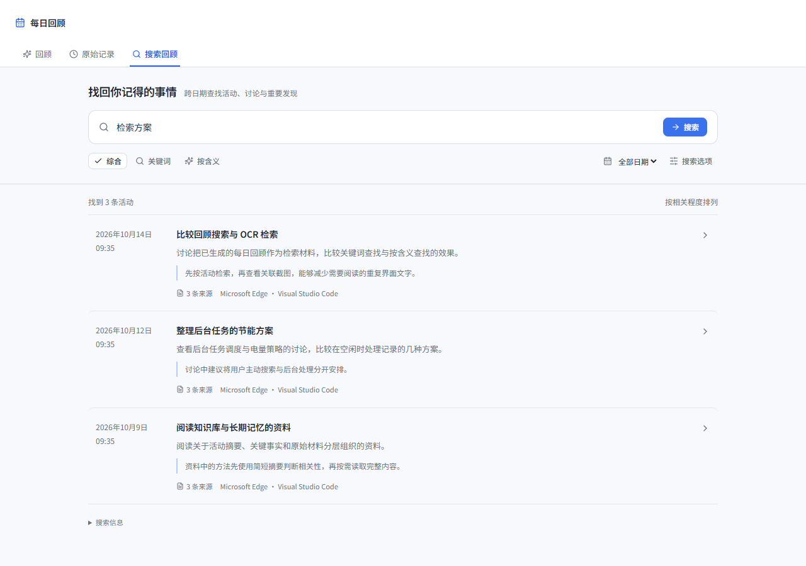
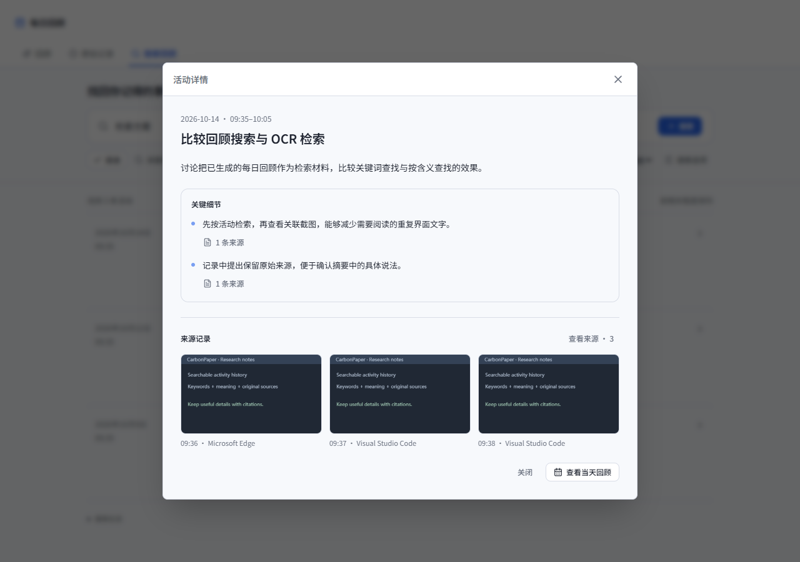

# Searchable recap experiment

This branch combines cross-date activity retrieval with selective, cited key
details. Existing recaps become searchable immediately by keyword. Local MiniLM
embeddings add meaning-based retrieval after an explicit preparation step.
Newly generated recaps preserve a few concrete details for important activities.

## Try it

1. Open **Daily recap → Search recaps**. Enter a description or keywords and
   optionally choose a date range. Results are activities with dates and sources.
2. Choose **Prepare search** to enable meaning-based retrieval across saved
   recaps. Preparation is local, reports progress, can be stopped, and resumes
   from encrypted saved vectors. It does not regenerate summaries or call the
   configured remote recap provider.
3. Compare **Keywords**, **By meaning**, and **Combined**. Under **Options**,
   toggle **Search key details** to compare the same activities with and without
   their additional facts. Changing filters refreshes an existing search.
4. Open a result to read its key details and screenshots. Each detail has its
   own source action. Closing a source dialog returns to the activity; closing
   the activity retains the search. **Open daily recap** returns to that date.
5. In **Settings → Organize → Daily recap → Advanced**, **Keep important details**
   controls new generation. It defaults on in this experimental branch. To
   enrich an existing day, use that day's **Regenerate** action. This uses the
   existing provider, consent and generation budgets; older recaps are not
   automatically regenerated.

The existing `npm run debug` workflow runs the experiment from its worktree.
It uses the normal local database, registry settings and Windows CNG key, as
documented in `AGENTS.md`. UI preview screenshots below use synthetic records.

## Interface

The search tab stays available for saved history when recap generation is
disabled. Empty history, no matches, pending preparation, partial coverage and
unavailable inference have distinct messages. Combined search explicitly reports
keyword fallback; meaning-only search requires an available index. Detailed
query timing and index counts stay in a disclosure rather than the main flow.

## Generation and evidence

- The extraction request selects up to three important activities per period,
  with up to three details each, at most 300 characters per detail. The local
  postprocessor enforces the selected-activity bound and the saved setting.
- Prompts prioritize useful discoveries, comparisons, decisions, explicit
  outcomes and unresolved questions. Brief events can qualify. Existing targeted
  gap requests can obtain additional evidence within the same request budgets.
- Detail citations must be nonempty subsets of the activity's received evidence.
  Existing segment and source validation still applies. Reading, proposals,
  attributed reports and completed work remain distinct in the prompt.
- Correcting an activity's task retains a detail only when all its cited sources
  belong to that corrected activity. Summaries receive the supported details.
- Old payloads deserialize with empty details. The addition does not force a
  rewrite of saved activity text or a paid regeneration.

Citation validation establishes source identity, not factual entailment. Inspect
the cited material when judging generation quality.

## Retrieval and storage

The searchable unit is a corrected activity, not a whole day. Titles,
descriptions and details are encoded separately in overlapping windows. A
72-byte title prefix and 160-byte content window leave conservative space under
the current encoder's 256-token limit. Full titles also have their own windows.
Content fingerprints include the search contract and MiniLM vector-space
revision; the screenshot index and its 30-day expiry are not reused.

Keyword retrieval normalizes case and punctuation, requires all whitespace-
separated query terms, and boosts title and phrase matches. Meaning retrieval
uses the best positive cosine score among an activity's included windows and
retains up to 200 semantic candidates. Combined retrieval uses reciprocal rank
fusion with a constant of 60. Only the requested page's source metadata is
cloned into results. Similarity is a retrieval signal, not proof of an event.

Vectors are stored as encrypted `recap_payloads` of kind `search`, grouped by
date. Preparation commits small batches so cancellation preserves completed
work. Search itself never starts preparation. The index covers all saved dates,
independently of the calendar discovery API's 730-date limit.

A resident activity projection avoids decrypting every recap for every query.
Its identity includes database generation, a source/correction epoch, privacy
policy and authenticated session. Lock notifications clear it and cancel
preparation. Every composed read checks its identity before returning; a later
unlock cannot authorize a request from the preceding session. Plaintext and
vectors in the resident projection are zeroized when its last reference drops.

Source edits, recap regeneration, corrections and deletions invalidate the
projection. Screenshot deletion also purges persisted search payloads. Search
refilters generated text, corrected names, details and source identities before
returning data. Privacy and source changes during indexing or inference reject
the operation rather than publish results from the old identity.

Pagination includes a `ranking_revision`: source changes, changed search options
or newly prepared semantic vectors cannot silently mix two rankings. Restart
the query when `RECAP_SEARCH_RESULTS_CHANGED` is returned.

## AI and MCP

`search_recaps` is in the shared read-only catalog. It uses the same implementation
as the UI and returns dates, corrected activities, key details, screenshot
references, coverage and pagination. Screenshot timestamps remain Unix
milliseconds in the MCP contract. Pass the response's `ranking_revision` with
later pages; restart without it when the ranking changes.
Executed local date bounds are retained in AI turn context so later follow-up
questions keep the originally searched dates.

AI can inspect a relevant activity and then verify its sources with
`get_snapshot_details`. Missing or filtered recap content does not prove that an
activity never happened. OCR and image search remain available when details
were omitted from the recap.

## Evaluate the combined experiment

Use the same locally selected questions and saved corpus for each comparison:

| Comparison | What it isolates |
|---|---|
| Keywords / By meaning / Combined, details excluded | Retrieval over short activity descriptions |
| Same mode, details included / excluded | Additional retrieval value of preserved facts |
| Current AI tools / AI with `search_recaps`, same model and call budget | End-to-end time, calls, context usage and citation accuracy |

Include exact names, paraphrases, activities repeated across dates, facts omitted
from summaries, and questions with no recorded answer. Record relevant activity
and screenshot IDs, top-ten retrieval, final answer correctness, citations, cold
and warm query time, indexing time and memory, and generation cost separately.
The UI's query time includes corpus loading and query encoding, but excludes
past preparation and recap generation. Do not infer end-to-end improvements
from the ranking unit tests or synthetic UI screenshots.

Relevant checks are `npm run test:frontend`, `npm run build`, `npm run lint:ci`,
`npm run i18n:check`, `npm run test:security`, `npm run test:mcp-contract`,
`cargo check --manifest-path src-tauri/Cargo.toml`, and
`cargo test --manifest-path src-tauri/Cargo.toml --lib`.

Validation on Windows for this implementation: 558 frontend tests passed;
851 Rust library tests passed and eight existing opt-in tests were ignored.
Build, lint, locale parity, security guards, Cargo check and MCP contract checks
passed. Chrome previews exercised light/dark themes, Chinese/English controls,
1280-pixel and 560-pixel layouts, empty results, filters, nested source dialogs,
and preparation/cancellation using synthetic records. Real-provider generation
quality and retrieval performance on personal history were not benchmarked.
